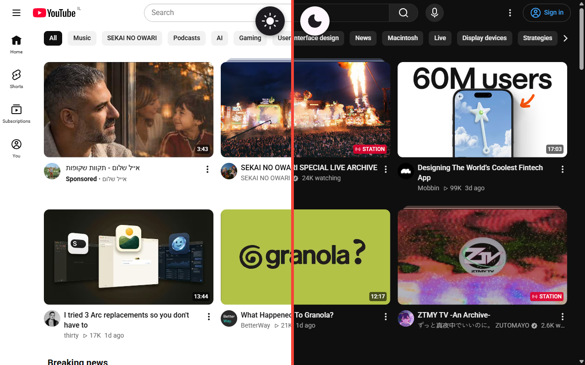

# YouTube Auto Dark

Makes YouTube's own "Use device theme" setting live. When your system flips between light and dark, open
`www.youtube.com` tabs re-theme in place, with no reload. If you picked Dark or Light in YouTube's appearance menu, the
extension leaves the page alone. There is no popup and there are no settings.



\
\


## How it works

YouTube only records a device-theme change for the next page load. This extension runs in the page's own context and
re-themes the open page the way YouTube would if it didn't reload: its theme attributes, the values its components
cached from them, its own theme action, live chat, palettes, and the text and panel content the server colored for the
old theme. The step-by-step reverse-engineering notes are in [CLAUDE.md](CLAUDE.md).

## Development

Requires [Bun](https://bun.com) 1.4.5 and, for the dev server, [Rust](https://rustup.rs).

```sh
bun install
bun run dev           # Chrome for Testing, with live reload of the extension and open YouTube tabs
bun run dev:firefox   # the installed Firefox
bun run build         # production build in build/ (build:firefox, build:opera for the others)
bun run zip           # store package and source archive (zip:firefox, zip:opera for the others)
```

Before sending a change, `bun run lint`, `bun run compile`, `bun run test` and `bunx fallow dead-code --root .` must all
report no findings. A change to the dev server also needs `cargo clippy --all-targets` and `cargo test` to pass in
`dev-server/` and `tools/`.

The dev server is two Rust crates: [dev-server](dev-server) (file watching, the rebuild loop and the browser
protocols) and [tools](tools) (building, browser profiles and launching). The first `bun run dev` downloads Chrome for
Testing into `.chrome-for-testing/`, since branded Chrome no longer sideloads from the command line. Its profile is
`user-profiles/chrome-for-testing`; sign in to YouTube there once if you need a signed-in session.

## License

Copyright (C) 2026 Avi

This program is free software: you can redistribute it and/or modify it under the terms of the GNU General Public
License as published by the Free Software Foundation, version 3.

This program is distributed in the hope that it will be useful, but WITHOUT ANY WARRANTY; without even the implied
warranty of MERCHANTABILITY or FITNESS FOR A PARTICULAR PURPOSE. See the [LICENSE](LICENSE) file for the full text.

The dev server crates are adapted from the same author's youtube-downloader (originally under Apache License 2.0).

The icon's contrast glyph is from [Material Symbols](https://fonts.google.com/icons) (Apache License 2.0).
